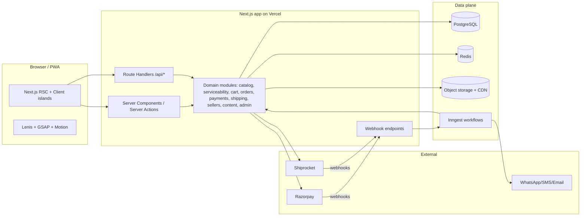
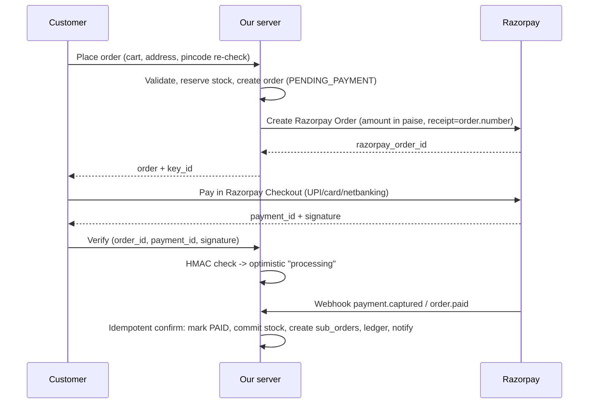

# Rasvani — Technical Document

| | |
|---|---|
| **Version / Date** | v0.1 draft · 30 Oct 2026 |
| **Audience** | Developers, AI coding agents, technical reviewers |
| **Related** | `01-PRD.md` (what), `03-APP-FLOW.md` (flows/state machines), `04-AI-RULES.md` (coding rules), `05-DESIGN.md` (UI/motion) |

---

## 1. Technology Philosophy: "Newest where safe, stable where it matters"

We use a **three-tier policy** so the site feels cutting-edge without risking checkout, payments or SEO.

| Tier | Meaning | Rule |
|---|---|---|
| **A — Core (stable)** | Released, supported, widely used. Everything revenue-critical lives here. | Pin exact versions; upgrade deliberately (patch weekly, minor monthly, major with a branch + tests). |
| **B — Progressive enhancement (newest)** | Newer browser/framework features that are great when present. | Always **feature-detected** with a graceful fallback; never required to complete a purchase. |
| **C — Not yet** | Experimental/canary/alpha, or "cool" but risky. | **Do not use** in production. Revisit quarterly. |

> **Version note:** versions below are the lines verified on 30 Oct 2026. Before starting the repo run `npm view <pkg> version` for each and pin the exact latest stable. Next.js now ships **scheduled security releases**: subscribe to the Next.js security feed and keep within the latest patch of the supported major.

## 2. Recommended Stack

### 2.1 Frontend (Tier A unless noted)

| Concern | Choice | Notes |
|---|---|---|
| Framework | **Next.js 16.x (App Router, Turbopack)** | 16.x is the Active LTS line; use the newest patch. SSR/ISR/streaming for SEO + speed. |
| UI library | **React 19.2.x** + **React Compiler 1.0** (stable) | Compiler reduces manual `useMemo/useCallback`. |
| Language | **TypeScript (strict)** | `noUncheckedIndexedAccess`, no `any`. |
| Styling | **Tailwind CSS 4.3.x** (CSS-first `@theme`) | Design tokens live in CSS (see `05-DESIGN.md`). |
| Components | **shadcn/ui + Radix primitives** | Accessible by default; we own the code. |
| Scroll | **Lenis** (smooth scroll) synced to **GSAP ScrollTrigger** | Single RAF driver (gsap.ticker). Desktop/pointer-fine only; native scroll on touch. |
| Animation (timeline/scroll/text/SVG) | **GSAP 3.13+** (`gsap`, `@gsap/react` `useGSAP`) — core, ScrollTrigger, SplitText, Flip, DrawSVG, MorphSVG as needed | GSAP and all its plugins became free (incl. commercial use) after the Webflow acquisition; install from the public npm package, no tokens. |
| Animation (UI micro-interactions, layout, gestures, springs) | **Motion** (`motion/react`, formerly Framer Motion) | Cart drawer, buttons, presence/exit animations. |
| Page transitions | **Native View Transitions API** (Tier B) via a small wrapper | Progressive enhancement; fallback = instant navigation. React's `<ViewTransition>` component: use only once it is stable (Tier C today). |
| Instant navigation | Next.js 16.3 "Instant Navigations" (`cacheComponents`, partial prefetching) | **Tier B — opt-in behind a flag**, test before enabling by default. |
| Forms/validation | **React Hook Form + Zod** | Same Zod schemas shared with server actions. |
| Server state | **TanStack Query** (client-only interactive parts) | Most data comes via RSC; keep client fetching minimal. |
| Client state | **Zustand** (cart UI state, cursor state) | Cart truth lives on the server. |
| Maps | Build-time **SVG India map** generated from boundary GeoJSON via `d3-geo` + `topojson-client` | Ship only the generated SVG paths — not the libraries. Boundary source must follow official Survey of India depiction. |
| Icons | `lucide-react` (+ custom food/region icon set) | |
| i18n | **next-intl** | English + Hindi at launch; message catalogue per locale; native-script dish names stored in DB. |
| Fonts | `next/font` (self-hosted) | See design doc; include Devanagari. |
| PWA | Web App Manifest + service worker via Serwist (P1) | Installable, offline shell for order tracking. |
| Optional later (Tier C for MVP) | WebGL hero (OGL / Three.js / R3F), Rive/Lottie | Only after performance budgets are proven on target devices. |

### 2.2 Backend & Data

| Concern | Choice | Notes |
|---|---|---|
| Architecture | **Modular monolith** inside the Next.js app (route handlers + server actions + domain modules) | Easy for a small team; clean module boundaries allow extraction later. |
| Runtime | Node.js **Active LTS** (check nodejs.org when scaffolding) | |
| Database | **PostgreSQL** (managed, India region — e.g., Supabase/AWS Mumbai) | One relational source of truth. |
| ORM / migrations | **Drizzle ORM + drizzle-kit** | SQL-first; good for FTS/trigram queries. |
| Auth | **Supabase Auth** (phone OTP via SMS/WhatsApp hook + Google/email) *or* Auth.js | Roles: customer, seller, admin sub-roles. Sessions in httpOnly cookies. Row-level security as defence-in-depth. |
| Cache / rate-limit | **Upstash Redis** | Rate limits (OTP, search, pincode), serviceability cache, short-lived reservations. |
| Background jobs / workflows | **Inngest** (or Trigger.dev) | Webhook processing, notifications, payout runs, retries, scheduled jobs. |
| Search | **Phase 1:** Postgres FTS + `pg_trgm` + alias/transliteration table. **Phase 2:** Typesense/Meilisearch (or Algolia) | Aliases (Pharra/Farra/Faraa/फरा) are first-class data. |
| File/media storage | **Cloudflare R2 / Supabase Storage** + image CDN (Cloudinary or Cloudflare Images) | AVIF/WebP, responsive sizes, blurhash placeholders. Seller KYC docs in a **private** bucket. |
| CMS (stories, makers, festivals) | Start inside Admin (DB + rich text/MDX); consider Sanity/Payload later | Avoid a second system until needed. |
| Email | **Resend + React Email** | Transactional only. |
| WhatsApp/SMS | WhatsApp Business API provider (e.g., Meta Cloud API via Gupshup/Interakt/AiSensy) + SMS with **DLT-registered** templates (e.g., MSG91) | OTP + order updates. [VERIFY provider pricing/limits] |

### 2.3 Third-party Integrations

| Domain | Provider (proposed) | Used for |
|---|---|---|
| Payments | **Razorpay** (Standard Checkout; Orders API; Webhooks; Refunds; Route for split settlements if eligible) | UPI, cards, netbanking, wallets, refunds, seller payouts |
| Shipping aggregator | **Shiprocket** (serviceability, order create, AWB, pickup, tracking webhooks, NDR) | Intercity delivery to wide PIN coverage via multiple couriers |
| Hyperlocal / same-city | A hyperlocal courier API (e.g., Porter/Borzo-type) **[VERIFY availability per city]** | Fresh/perishable local deliveries |
| Address/PIN data | India Post PIN directory dataset (loaded into our `pincodes` table) + optional address-autocomplete | Validation, city/state auto-fill |
| Analytics & product | **PostHog** (events, funnels, flags) + GA4 | Funnel, demand insights |
| Errors & perf | **Sentry** + Vercel Speed Insights / Web Vitals | |
| Uptime | BetterStack/UptimeRobot | |

### 2.4 Hosting & DevOps
- **Frontend/App:** Vercel (Mumbai edge/regions where available) — or AWS/Cloudflare if cost requires.
- **DB/Storage:** India region (Mumbai, `ap-south-1`) to minimise latency.
- **CI/CD:** GitHub Actions → Vercel Preview per PR → staging → production (manual promote).
- **IaC:** minimal at start (platform dashboards + documented env), Terraform later.
- **Environments:** `local`, `staging` (Razorpay/Shiprocket sandbox, seeded data), `production`.

## 3. High-Level Architecture



**Rendering strategy**
- Home, state, dish, collection, maker pages: **static/ISR + streaming**, revalidated on admin publish (on-demand `revalidateTag`).
- Product pages: ISR for content; **PIN check, price/stock freshness** fetched client-side/streamed, never cached globally.
- Cart, checkout, account, seller, admin: dynamic, authenticated, `no-store`.

## 4. Repository Structure

```
rasvani/
├─ AGENTS.md                     # = 04-AI-RULES.md (copy/symlink)
├─ docs/                         # 01..05 docs, ADRs (architecture decision records)
├─ src/
│  ├─ app/
│  │  ├─ (storefront)/           # home, states/[state], dishes/[slug], p/[slug], collections, makers
│  │  ├─ (checkout)/             # cart, checkout, order/[id]
│  │  ├─ (account)/              # profile, addresses, orders, favourites
│  │  ├─ seller/                 # seller portal
│  │  ├─ admin/                  # admin dashboard
│  │  └─ api/                    # route handlers + webhooks
│  ├─ modules/                   # domain logic (no UI)
│  │  ├─ catalog/ serviceability/ cart/ orders/ payments/ shipping/
│  │  ├─ sellers/ content/ notifications/ search/ auth/ ledger/
│  │  └─ <module>/{schema.ts, service.ts, queries.ts, types.ts, __tests__}
│  ├─ components/
│  │  ├─ ui/                     # shadcn primitives
│  │  ├─ motion/                 # SmoothScroll, Cursor, Reveal, SplitHeading, Marquee, Magnetic…
│  │  ├─ map/                    # IndiaMap, StateTooltip, StateSheet
│  │  └─ features/               # ProductCard, PinCheck, OrderTimeline, …
│  ├─ lib/                       # db client, redis, razorpay, shiprocket, env, utils
│  ├─ styles/                    # globals.css (@theme tokens)
│  └─ i18n/                      # messages/en.json, hi.json
├─ db/{migrations,seed}/         # drizzle migrations; seed from 28-state list
├─ scripts/                      # build-india-map.ts, import-pincodes.ts
├─ e2e/                          # Playwright
└─ .github/workflows/
```

Rules: UI never talks to the DB directly; **only `modules/*` touch the DB and third parties**. Server-only code is marked with `import 'server-only'`.

## 5. Data Model (core tables)

All IDs: UUIDv7/ULID. Money: **integer paise** (`bigint`). Timestamps: `timestamptz` UTC (display in IST). Soft-delete where audit matters.

**Geography & Library**
- `states` (id, code, name, native_name, kind: STATE|UT, slug, story, hero_media, sort)
- `regions` (id, state_id, name, native_name, slug)
- `dishes` (id, slug, name, native_name, category, description, story, veg_status: CONFIRMED|NEEDS_CONFIRMATION, veg_notes, festival_tags[], is_published)
- `dish_regions` (dish_id, state_id, region_id nullable, association_note) — **many-to-many**
- `dish_aliases` (dish_id, alias, script, locale) — drives search

**Commerce**
- `sellers` (id, display_name, legal_name, story, state_id, region_id, city, pincode, status: APPLIED|IN_REVIEW|VERIFIED|SUSPENDED|REJECTED, badges, commission_bps, payout_account_ref, handling_hours, dispatch_days, rating_avg)
- `seller_documents` (seller_id, type: FSSAI|PAN|GST|BANK|ADDRESS|AGREEMENT, file_ref(private), number_masked, status, verified_by, verified_at, expires_at)
- `seller_pickup_locations` (id, seller_id, address, pincode, contact)
- `products` (id, dish_id nullable, seller_id, slug, title, native_title, description, category, veg_type, jain_friendly, no_onion_garlic, vegan, allergens[], ingredients, shelf_life_days, storage, delivery_class, status: DRAFT|PENDING_REVIEW|ACTIVE|PAUSED|REJECTED, origin_verified bool, gi_tag, fssai_ref)
- `product_variants` (id, product_id, sku, label, net_weight_g, price_paise, mrp_paise, gst_rate_bps, hsn, weight_g_packed, dims_mm)
- `inventory` (variant_id, on_hand, reserved, low_stock_threshold, daily_capacity)
- `inventory_reservations` (id, variant_id, cart_or_order_ref, qty, expires_at, status)
- `product_media` (product_id, kind: IMAGE|VIDEO, url, alt, sort, is_real_photo bool)

**Serviceability**
- `pincodes` (pincode PK, city, district, state_id, lat, lng)
- `delivery_rules` (id, delivery_class, max_transit_hours, allowed_methods[], blackout_dates, cutoff_time)
- `serviceability_cache` (origin_pin, dest_pin, delivery_class, courier_ref, etd_hours, cost_paise, checked_at, ttl)
- `hyperlocal_zones` (id, city, pincodes[], partner)

**Orders & Money**
- `carts`, `cart_items` (guest via cookie id; merged on login)
- `orders` (id, number, customer_id, address_snapshot, totals_*, status, payment_status, placed_at)
- `sub_orders` (id, order_id, seller_id, status, pickup_location_id, handling_due_at)
- `order_items` (sub_order_id, variant_id, title_snapshot, price_paise, qty, tax_*)
- `payments` (id, order_id, provider, provider_order_id, provider_payment_id, amount_paise, status, method, raw_event_ref)
- `refunds` (id, payment_id, order_item_id nullable, amount_paise, reason, status, provider_refund_id)
- `shipments` (id, sub_order_id, provider, provider_shipment_id, awb, courier, label_url, status, etd, delivered_at)
- `shipment_events` (shipment_id, provider_status, mapped_status, location, occurred_at, raw)
- `ledger_entries` (id, account: PLATFORM|SELLER:<id>|GATEWAY, order_id, type: SALE|COMMISSION|SHIPPING|REFUND|PAYOUT|TCS|TDS, amount_paise, occurred_at) — **append-only**
- `payouts` (id, seller_id, period, amount_paise, status, reference)

**Content & Engagement**
- `collections` (id, slug, title, kind: FESTIVAL|BOX|EDITORIAL, starts_at, ends_at, hero, is_published) + `collection_items`
- `boxes` (id, collection_id, title, price, contents[])
- `reviews` (id, product_id, order_item_id, rating, body, media, status) — verified purchase only
- `favourites` (user_id, product_id/dish_id)
- `waitlist_requests` (id, dish_id/product_id, pincode, contact, created_at)
- `search_logs` (query, filters, result_count, pincode_hash, at)

**Platform**
- `users`, `profiles`, `addresses`, `roles`, `staff_members`
- `support_tickets`, `ticket_messages`, `notifications`, `audit_logs`, `feature_flags`, `webhook_events` (provider, event_id UNIQUE, payload, processed_at)

## 6. Key Domain Algorithms

### 6.1 Serviceability engine
Input: `(variantId | productId, destPincode, qty?)`. Steps:
1. Load product, seller pickup pincode, delivery class, stock, seller status; reject if inactive.
2. Check `pincodes` for destination validity.
3. Apply class rules:
   - `SHELF_STABLE`: ask courier cache/Shiprocket serviceability (origin→dest, weight) → ETA + cost.
   - `SHORT_LIFE`: require express/air eligible lanes and `etd_hours ≤ max_transit_hours`; apply seller cut-off/dispatch days.
   - `FRESH`: only if dest pincode ∈ `hyperlocal_zones` of seller's city/region and a partner is available.
4. Compute `estimated_delivery_window = next_dispatch_slot + etd`.
5. Return `{status: AVAILABLE | AVAILABLE_LIMITED | UNAVAILABLE | UNKNOWN, reason_code, eta_from, eta_to, shipping_fee_paise}`.
6. **Cache** per (origin, dest, class) with short TTL (e.g., 6–24 h) in Redis/DB; **UNKNOWN is shown as "can't confirm", never as available**. Re-check at checkout and before creating the Razorpay order.

### 6.2 Inventory reservation
At "Proceed to pay" → create reservations (`expires_at = now + 15 min`) in a transaction using `SELECT … FOR UPDATE` on inventory rows. Expiry job releases stale reservations. On payment success, convert to committed decrement.

### 6.3 Payment flow (Razorpay)

Rules: **webhook is the source of truth**; client verification only improves UX. Webhook handler verifies `x-razorpay-signature` over the **raw body**, stores `event_id` in `webhook_events` (unique) for idempotency, and returns 200 quickly, then processes in a job.

```ts
// modules/payments/verify.ts
import 'server-only';
import crypto from 'node:crypto';

export function verifyCheckoutSignature(orderId: string, paymentId: string, signature: string, secret: string) {
  const expected = crypto.createHmac('sha256', secret).update(`${orderId}|${paymentId}`).digest('hex');
  const a = Buffer.from(expected); const b = Buffer.from(signature);
  return a.length === b.length && crypto.timingSafeEqual(a, b);
}

export function verifyWebhookSignature(rawBody: string, signature: string, webhookSecret: string) {
  const expected = crypto.createHmac('sha256', webhookSecret).update(rawBody).digest('hex');
  const a = Buffer.from(expected); const b = Buffer.from(signature);
  return a.length === b.length && crypto.timingSafeEqual(a, b);
}
```

### 6.4 Shipping flow (Shiprocket)
1. Seller marks sub-order **Packed** → job creates the Shiprocket order (pickup location, dimensions, weight, items) → assigns courier/AWB → label URL stored → pickup scheduled.
2. Shiprocket tracking webhooks → `shipment_events` → map provider statuses to our statuses (§7) → update sub-order → notify customer.
3. Exceptions: NDR (failed attempt) → support queue + customer action; RTO → refund/replacement workflow; damaged claim → ticket with photos.
4. Poll fallback job for shipments with no webhook for N hours.

### 6.5 Search
- Normalise query (lowercase, strip diacritics, Devanagari↔Latin transliteration map), expand via `dish_aliases`, rank: exact alias > prefix > trigram similarity > FTS rank; boost in-stock and **serviceable to user's PIN**; log queries/no-results for demand insights.
- "Traditional snacks from Rajasthan" → lightweight parser extracts `state=Rajasthan`, `category=snacks`; fall back to FTS.

### 6.6 Payouts & ledger
Append-only `ledger_entries` for every sale/commission/refund/shipping/tax. Payout run (weekly) sums settled & delivered orders minus returns window. [VERIFY] with CA: GST on commission, TCS (e-commerce operator), TDS rules, and gateway marketplace settlement terms.

## 7. Status Models (canonical)

**Order (customer-facing):** `PENDING_PAYMENT → CONFIRMED → PREPARING → PACKED → DISPATCHED → OUT_FOR_DELIVERY → DELIVERED`; terminals/side: `CANCELLED`, `DELAYED` (flag), `DELIVERY_FAILED`, `RETURNED_TO_ORIGIN`, `REFUNDED`.
UI maps to the founder's five steps: **Confirmed, Prepared, Packed, Dispatched, Delivered**.
Full diagrams: `03-APP-FLOW.md`.

## 8. API Surface (internal, REST-ish route handlers + server actions)

| Area | Endpoint / Action | Notes |
|---|---|---|
| Catalog | `GET /api/search?q=&state=&category=&pin=` | rate-limited, cached |
| | `GET /api/states`, `/api/states/:slug`, `/api/dishes/:slug`, `/api/products/:slug` | mostly RSC direct calls |
| Serviceability | `POST /api/serviceability` `{productId|variantId, pincode}` | Zod-validated, rate-limited, never cached publicly |
| Cart | server actions: `addToCart`, `updateQty`, `removeItem`, `applyCoupon` | cookie-based guest cart |
| Checkout | `POST /api/checkout/create-order` | re-validates price, stock, serviceability |
| | `POST /api/checkout/verify` | signature check |
| Webhooks | `POST /api/webhooks/razorpay`, `POST /api/webhooks/shiprocket`, `POST /api/webhooks/whatsapp` | raw body, signature verified, idempotent |
| Orders | `GET /api/orders`, `/api/orders/:id`, `POST /api/orders/:id/cancel`, `/issue` | owner-scoped |
| Seller | `/seller/*` actions: products, inventory, orders, pickups, earnings | seller-scoped RLS |
| Admin | `/admin/*` actions | role-checked + audit logged |
| Waitlist | `POST /api/waitlist` | rate-limited |

All inputs validated with **Zod**; all outputs typed; errors use a single envelope `{ code, message, details? }`.

## 9. Security

- **Secrets** only in server env; `NEXT_PUBLIC_*` only for non-secret keys (e.g., Razorpay `key_id`). Validate env at boot with Zod.
- **AuthZ:** every server action/route checks role + ownership; DB RLS as a second layer; seller can only access own rows; admin actions audit-logged.
- **OTP abuse:** per-phone + per-IP rate limits, cooldown, lockout; consider Turnstile/hCaptcha on OTP request.
- **Webhooks:** signature verification, replay protection, idempotency table.
- **Payments:** amounts computed server-side only; never trust client totals; refunds only via admin/server.
- **Headers:** CSP (nonce-based), HSTS, `X-Content-Type-Options`, `Referrer-Policy`, frame-ancestors none; allow Razorpay domains in CSP.
- **Uploads:** content-type + size checks, virus scan (ClamAV/Cloud function), strip EXIF, private bucket for KYC docs, signed URLs with short expiry.
- **PII:** minimise; encrypt sensitive fields (bank details tokenised via gateway where possible); retention policy; DPDP consent log.
- **Dependencies:** Dependabot/Renovate, `npm audit` in CI, lockfile committed, Next.js security-release subscription.
- **Backups:** daily + PITR; restore drill each quarter.

## 10. Performance Budgets & Rules

| Item | Budget |
|---|---|
| LCP / INP / CLS (p75 mobile) | ≤ 2.5 s / ≤ 200 ms / ≤ 0.1 |
| Initial JS per route (gzipped) | Home ≤ 220 KB, PDP ≤ 180 KB, Checkout ≤ 150 KB |
| Hero media | Poster image ≤ 150 KB (AVIF/WebP); optional video ≤ 1.5 MB, lazy, muted, `playsinline`; no autoplay video on Save-Data/slow networks |
| Images | `next/image`, explicit dimensions, `sizes`, blurhash/LQIP, AVIF first |
| Animation | Only animate `transform`, `opacity`, `clip-path`, `filter` (sparingly); **no layout-thrashing animation**; `will-change` scoped; kill ScrollTriggers on unmount (`useGSAP` handles cleanup); lazy-load GSAP plugins per route |
| Third-party scripts | Load Razorpay script only on checkout; analytics deferred |
| Fonts | ≤ 3 families/weights subset, `font-display: swap`, Devanagari subset |

Enforce via **Lighthouse CI** and **Web Vitals** monitoring; fail PRs that exceed budgets on key routes.

## 11. Testing & Quality

| Layer | Tool | Scope |
|---|---|---|
| Unit | **Vitest** | Domain modules: pricing/tax, serviceability rules, status mapping, signature verification |
| Component | React Testing Library | Cart, PinCheck, filters |
| E2E | **Playwright** | Browse → PIN check → cart → checkout (Razorpay test mode) → webhook simulate → tracking; seller onboarding; admin approvals; mobile viewport projects |
| Accessibility | `axe-core` in Playwright, manual keyboard & screen-reader pass | WCAG 2.2 AA |
| Visual regression | Playwright screenshots (reduced-motion mode) | Key pages |
| Performance | Lighthouse CI | Budgets above |
| Contract | Recorded fixtures for Razorpay/Shiprocket payloads | Webhook handlers |
| Load | k6 on search/PIN/checkout before Diwali/Chhath | Spikes |

**CI pipeline:** install → typecheck → lint/format (Biome) → unit → build → e2e (preview) → Lighthouse → deploy preview. Migrations run in a controlled step with rollback plan.

## 12. Observability & Operations
- Structured logs with request/order IDs; Sentry for errors (client + server); PostHog funnels (map click → state view → PDP → PIN check → add to cart → pay).
- Alerts: payment webhook failures, stuck `PENDING_PAYMENT` > 30 min, shipments without updates > 24 h, job failure rate, 5xx rate, Web Vitals regressions.
- Runbooks (in `docs/runbooks/`): payment mismatch, stuck shipment, mass-delay (weather/strike), refund failures, data export/delete request.

## 13. Internationalisation
Locale routing `/en`, `/hi`; all UI strings in message catalogues; DB entities carry `native_name` fields (and later translation tables); number/date/currency formatting via `Intl` (INR, IST); font stacks for each script; text expansion tolerant layouts.

## 14. Scaling Path
1. **MVP:** single Vercel project + one Postgres + Redis + Inngest.
2. **Growth:** read replicas, search engine (Typesense/Meilisearch), CDN-cached catalogue, queue-based notifications, separate seller/admin deployments if needed.
3. **Scale:** extract `payments`, `shipping`, `notifications` modules to services; event bus; data warehouse (BigQuery/ClickHouse) for demand analytics; multi-hub inventory.

## 15. Environment Variables (names only)
`DATABASE_URL`, `REDIS_URL`, `AUTH_SECRET`, `NEXT_PUBLIC_SITE_URL`, `RAZORPAY_KEY_ID`, `RAZORPAY_KEY_SECRET`, `RAZORPAY_WEBHOOK_SECRET`, `SHIPROCKET_EMAIL`, `SHIPROCKET_PASSWORD` (API user), `INNGEST_EVENT_KEY`, `INNGEST_SIGNING_KEY`, `RESEND_API_KEY`, `WHATSAPP_TOKEN`, `SMS_AUTH_KEY`, `SENTRY_DSN`, `POSTHOG_KEY`, `STORAGE_*`, `IMAGE_CDN_*`. Never commit values; `.env.example` lists names only.

## 16. Build Plan (engineering milestones)
1. **Foundations (wk 1–2):** repo, CI, env validation, design tokens, base layout, i18n, auth, DB schema v1, seed 28-state Library.
2. **Storefront core (wk 3–6):** India map, state/dish pages, search, PDP, PIN check, collections, makers.
3. **Commerce (wk 6–9):** cart, checkout, Razorpay, orders, notifications, tracking timeline.
4. **Seller & Admin (wk 8–12):** onboarding/verification, product approvals, order handling, Shiprocket integration, payouts report.
5. **Polish & launch (wk 12–14):** motion pass, accessibility audit, performance tuning, load test, legal pages, pilot go-live.
(Indicative, assumes 2–3 engineers + 1 designer. Adjust to the actual team.)

## 17. Architecture Decision Records to write first
ADR-001 Modular monolith on Next.js · ADR-002 Postgres + Drizzle · ADR-003 Auth provider & OTP channel · ADR-004 Payments & split settlement · ADR-005 Shipping aggregator & hyperlocal partner · ADR-006 Motion stack & performance policy · ADR-007 Search roadmap · ADR-008 India map source & legal depiction.
