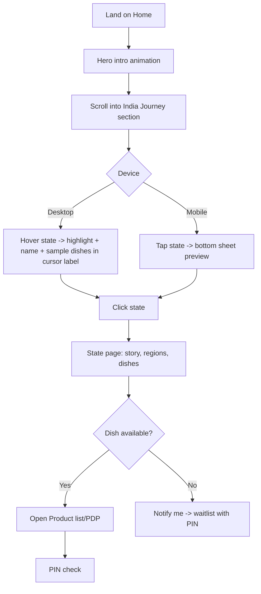
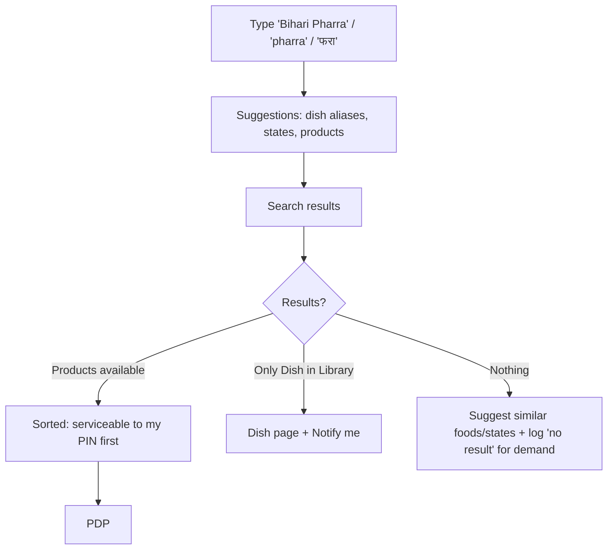
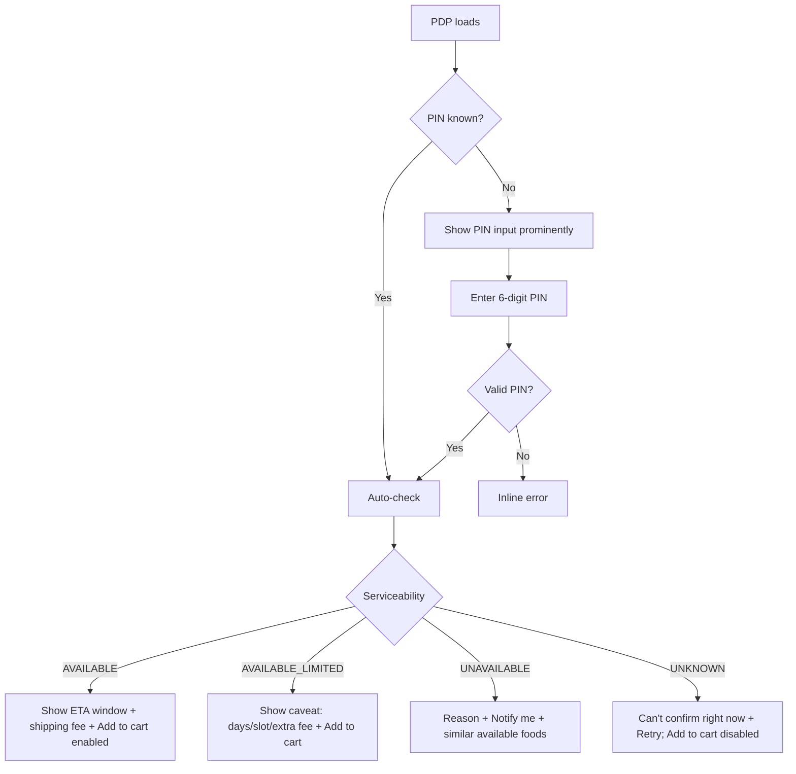
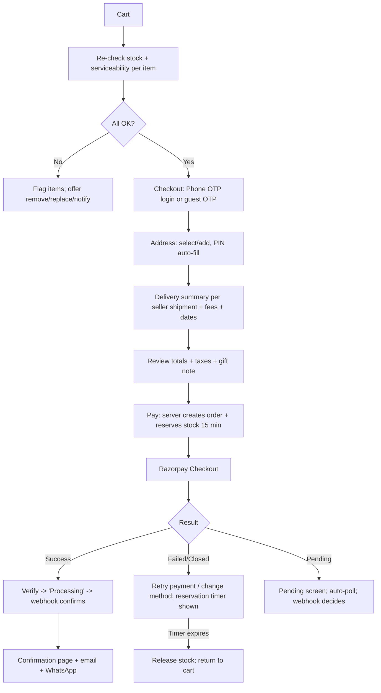
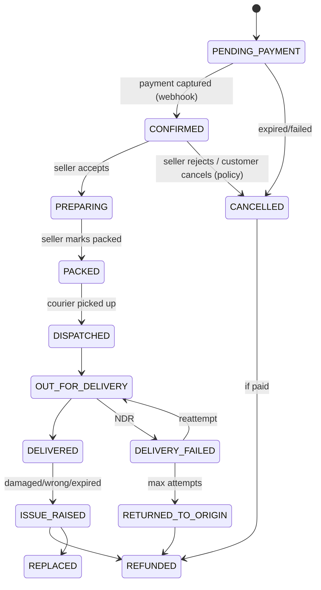
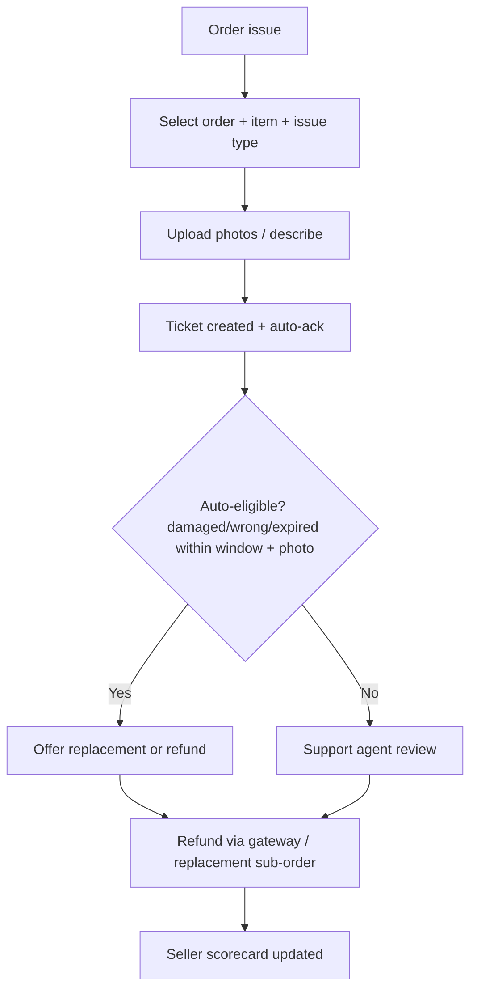
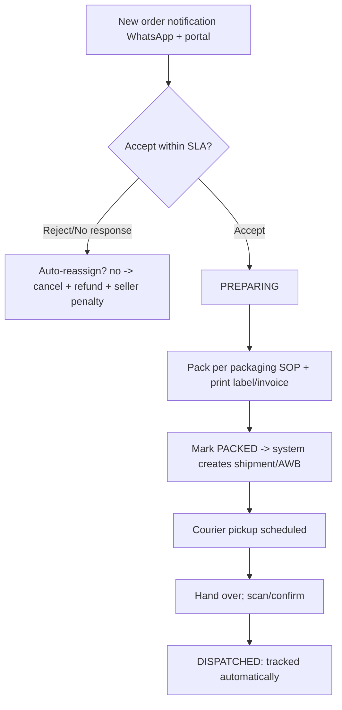

# Rasvani — App Flow Document

| | |
|---|---|
| **Version / Date** | v0.1 draft · 30 Oct 2026 |
| **Purpose** | Single reference for sitemap, screens, user journeys, state machines, edge cases and notifications. |
| **Related** | `01-PRD.md` (requirement IDs `FR-*`), `02-TECH.md`, `05-DESIGN.md` |

Diagrams use Mermaid (renders on GitHub, Notion, VS Code, most docs tools).

---

## 1. Actors
**Visitor** (not logged in) · **Customer** (phone-verified) · **Seller/Maker** · **Admin roles** (Super Admin, Catalogue, Ops, Support, Finance) · **System** (jobs/webhooks).

## 2. Sitemap

```
/                              Home (hero, India map journey, featured, festival, makers, how it works)
/states                        All states grid + map
/states/[state]                State page (story, regions, dishes, products, makers)
/states/[state]/[region]       (P1) Region page
/dishes/[slug]                 Dish (Library) page (P1)
/search?q=                     Search results (+ filters)
/p/[product-slug]              Product detail
/collections                   Festival & special collections
/collections/[slug]            e.g., chhath-puja, diwali, durga-puja
/boxes/[slug]                  Curated regional food boxes (P1)
/makers                        Meet the Makers
/makers/[slug]                 Maker profile
/stories/[slug]                Editorial/stories (P2)
/cart                          Cart
/checkout                      Address → Delivery → Payment
/order/[id]/confirmation       Confirmation
/account                       Dashboard
/account/orders[/id]           Orders, tracking, issues
/account/addresses             Address book
/account/favourites            Saved foods
/account/profile               Profile & preferences (home state, language)
/help                          FAQ, shipping, refunds, contact
/legal/*                       Terms, Privacy, Shipping, Refund, Seller agreement
/sell                          "Become a maker partner" landing + application
/seller/*                      Seller portal (see §6)
/admin/*                       Admin dashboard (see §7)
/waitlist                      "Notify me" confirmations (also inline)
```

## 3. Global Behaviours
- **Header:** logo, search (always visible), PIN chip ("Delivering to 800001 · Change"), account, cart (count), language toggle (EN/हिं).
- **PIN context:** remembered in cookie/localStorage + account; used site-wide to mark items "Delivers to you / Not available at your PIN / Check availability".
- **Footer:** about, makers, collections, help, legal, FSSAI/GST/company info, grievance officer.
- **Veg mark** (green dot) appears on every product card and PDP.
- **Reduced motion / low-power:** all animation degrades to simple fades or none (see `05-DESIGN.md`).
- **Errors:** friendly, retryable, never lose cart; unknown serviceability is shown as "can't confirm right now".

## 4. Customer Journeys

### 4.1 First-time discovery via the India map (FR-DISC-01/02)


### 4.2 Search for a specific food (FR-DISC-03)


### 4.3 Product page → PIN check (FR-PDP-*, FR-SVC-*)


### 4.4 Cart → Checkout → Payment → Confirmation


### 4.5 Order tracking & delivery (FR-TRK-*)
Steps shown to customer: **Confirmed → Prepared → Packed → Dispatched → Delivered** (+ *Out for delivery* between Dispatched and Delivered).

Customer actions by state: view timeline & courier link; cancel (only before PACKED); change address (only before PACKED, with re-check); raise issue after delivery within the policy window (photo upload); rate/review after delivery.

### 4.6 Post-delivery
Delivered → request review (WhatsApp/email) after N hours → "reorder" CTA → "Notify me for festival" prompt (e.g., before Chhath/Diwali).

### 4.7 Account (FR-ACC-*)
Login via phone OTP → Dashboard (recent orders, saved addresses, favourites, **home state** preference that personalises the home page) → manage addresses (add/edit/default/delete) → favourites → support tickets → language and notification preferences → data export/delete request.

### 4.8 Support & issues


## 5. Rules by Screen (key screens)

| Screen | Key states | Rules |
|---|---|---|
| **Home** | loading skeleton, ready, offline | Hero + map are above the fold within perf budget; map lazy-hydrates after LCP |
| **India Map** | idle, hover state, selected, keyboard focus, mobile sheet | Every state link-reachable with Tab; `aria-label` "Bihar — 7 traditional foods"; list fallback below the map |
| **State page** | has products / only dishes / empty | Always shows dishes (Library); products only when sellers exist |
| **Search results** | results, no results, offline | "Delivers to my PIN" filter default ON when PIN known |
| **PDP** | in stock, low stock, sold out, unserviceable, unknown | Add-to-cart disabled when UNAVAILABLE/UNKNOWN; sold-out → Notify me |
| **Cart** | empty, items OK, items flagged, min-order not met | Group by seller; show per-shipment ETA; no heavy animation |
| **Checkout** | step-by-step, validation errors, payment pending | Minimal motion; sticky summary; OTP resend cooldown 30 s |
| **Order tracking** | each status, delayed, failed | Timeline with timestamps, courier AWB, ETA |

## 6. Seller Journeys

### 6.1 Onboarding & verification (FR-SEL-01)
```mermaid
flowchart TD
  A[/sell landing] --> B[Apply: name, phone OTP, state/region, products, capacity]
  B --> C[Upload docs: FSSAI, PAN, GST?, bank, address]
  C --> D[Admin review]
  D --> E{Decision}
  E -- Need changes --> C
  E -- Reject --> R[Rejection reason + reapply policy]
  E -- Proceed --> F[Sample submission + tasting/QC + packaging check]
  F --> G{QC pass?}
  G -- No --> H[Feedback + resample]
  H --> F
  G -- Yes --> I[Sign agreement e-sign]
  I --> J[Profile + pickup location + bank verification]
  J --> K[Seller VERIFIED: can list products]
```

### 6.2 Product listing (FR-SEL-02)
Create product → choose **Dish** (from Library, or "suggest new dish") → variants & price → ingredients, allergens, veg declaration (mandatory, incl. recipe confirmation for flagged NE dishes) → shelf life, storage, delivery class → photos (min 3, real) → handling time & dispatch days → submit → **Admin approval** → Active. Edits to price/stock go live instantly; edits to ingredients/veg/claims re-trigger review.

### 6.3 Order handling (FR-SEL-04)

SLA examples (set per delivery class): accept ≤ 2 h (business hours), pack ≤ handling time, fresh items need same-day packing and cut-off adherence.

### 6.4 Earnings
Orders → delivered → return window closes → eligible for payout; statement shows gross, commission, shipping adjustments, refunds, taxes (TCS/TDS), net.

## 7. Admin Journeys

| Flow | Steps |
|---|---|
| **Seller verification** | Queue → open application → view docs → checklist (FSSAI valid & category fits, PAN/GST, bank match, address, samples) → approve / request changes / reject → audit log |
| **Product approval** | Queue → review photos, ingredients, veg declaration, shelf life, delivery class, claims ("authentic", GI) → approve/reject with reason |
| **Library management** | Add/edit state, region, dish, aliases, native names, veg notes; bulk import CSV; publish → triggers revalidation |
| **Order exceptions** | Dashboard of stuck/late/NDR/RTO orders → contact customer/seller → reroute, re-ship, refund |
| **Serviceability ops** | Configure PIN coverage by class, hyperlocal zones, blackout dates (e.g., festival rush, floods), per-seller dispatch days |
| **Content** | Collections (festival start/end), homepage modules, maker stories, banners |
| **Finance** | Reconcile payments vs bank, run payouts, GST/TCS reports |
| **Insights** | Unserviceable-PIN searches, waitlist counts by city, top searches, seller scores |

## 8. State Machines (reference)

**Seller:** `APPLIED → IN_REVIEW → (CHANGES_REQUESTED ↔ IN_REVIEW) → SAMPLE_QC → VERIFIED → SUSPENDED/REJECTED`
**Product:** `DRAFT → PENDING_REVIEW → ACTIVE ↔ PAUSED`; `PENDING_REVIEW → REJECTED`
**Payment:** `CREATED → AUTHORIZED/CAPTURED → (PARTIALLY_)REFUNDED`; `CREATED → FAILED`
**Shipment (mapped from courier):** `PENDING_PICKUP → PICKED_UP → IN_TRANSIT → OUT_FOR_DELIVERY → DELIVERED`; exceptions `NDR`, `RTO_INITIATED → RTO_DELIVERED`, `LOST`, `DAMAGED`
**Reservation:** `ACTIVE → COMMITTED | EXPIRED | RELEASED`

## 9. Edge Cases & Required Behaviour

| Case | Behaviour |
|---|---|
| Item becomes unserviceable between cart and pay | Block payment; explain; offer alternatives; keep other items |
| Stock runs out during checkout | Reservation prevents; if lost (expired) → message + retry |
| Payment succeeded but customer closed tab | Webhook confirms order anyway; email/WhatsApp sent; visible in account |
| Duplicate webhooks / out-of-order events | Idempotent via `webhook_events.event_id`; state machine ignores backwards transitions |
| Customer pays twice | Detect duplicate captured payments for same order → auto-refund extra |
| Multi-seller cart, one seller rejects | Partial cancel of that sub-order + partial refund; others proceed; notify |
| Seller misses dispatch SLA | Alert ops; notify customer with new ETA or offer cancel/refund |
| Courier delay (weather/strike) | Admin flags region → banners + customer notifications; blackout dates set |
| Perishable delivery missed/late | Auto-ticket, priority support, refund policy for spoilage |
| Address wrong / PIN mismatch | Validate PIN ↔ city/state; allow edit before PACKED |
| COD (if enabled) refusal | RTO flow; customer flagged after N RTOs |
| Dish has non-veg variants | Product blocked until veg recipe confirmed; badge "Vegetarian recipe confirmed" |
| Festival spike | Queue-based processing, capacity caps per seller, "sold out for this festival" messaging, cut-off dates shown early (e.g., "Order by 2 Nov for Chhath delivery") |
| Offline / slow network | Cached shell, retry banners, no lost cart |
| Language switch mid-flow | State preserved; native-script names shown |

## 10. Notification Matrix

| Event | Customer | Seller | Admin |
|---|---|---|---|
| OTP | SMS/WhatsApp | SMS/WhatsApp | — |
| Order placed & paid | Email + WhatsApp (+invoice) | WhatsApp + portal | Dashboard |
| Seller accepted/preparing | WhatsApp ("Prepared") | — | — |
| Packed | WhatsApp | — | — |
| Dispatched (AWB) | Email + WhatsApp | — | — |
| Out for delivery | WhatsApp/SMS | — | — |
| Delivered | Email + review request later | Portal | — |
| Delay/NDR | WhatsApp + email | Alert | Alert |
| Cancelled/Refunded | Email + WhatsApp | Alert | — |
| Low stock / SLA breach | — | WhatsApp | Alert |
| Back in stock / waitlist | Email/WhatsApp (with consent) | — | — |

Templates: bilingual (EN/HI), centrally managed, DLT/WhatsApp-approved before launch.

## 11. Analytics Events (minimum)
`map_state_hover`, `map_state_click`, `search_submit`, `search_no_results`, `pin_check` (result code), `pdp_view`, `add_to_cart`, `checkout_start`, `payment_attempt`, `payment_success/failed`, `waitlist_join`, `order_status_view`, `issue_raised`, `review_submitted`, `collection_view`, `language_switch`. Pseudonymise PINs where possible (hash or first 3 digits) and respect consent.

## 12. Acceptance Test Scenarios (E2E)
1. Visitor selects Bihar on the map → sees dishes → opens Thekua PDP → enters Delhi PIN → AVAILABLE → adds to cart → pays (test mode) → sees confirmation.
2. Search "farra" finds Faraa/Pharra (alias) and shows dish page with "Notify me" when no seller.
3. Fresh item PDP with Mumbai PIN while seller is in Patna → UNAVAILABLE with reason, similar shelf-stable alternatives.
4. Payment closed midway → retry succeeds without cart loss; reservation expiry releases stock.
5. Duplicate Razorpay webhook processed once.
6. Seller onboarding → admin approves → product approved → appears on state page.
7. Shiprocket "Delivered" webhook updates timeline and triggers review request.
8. All flows pass keyboard-only and `prefers-reduced-motion` runs.
